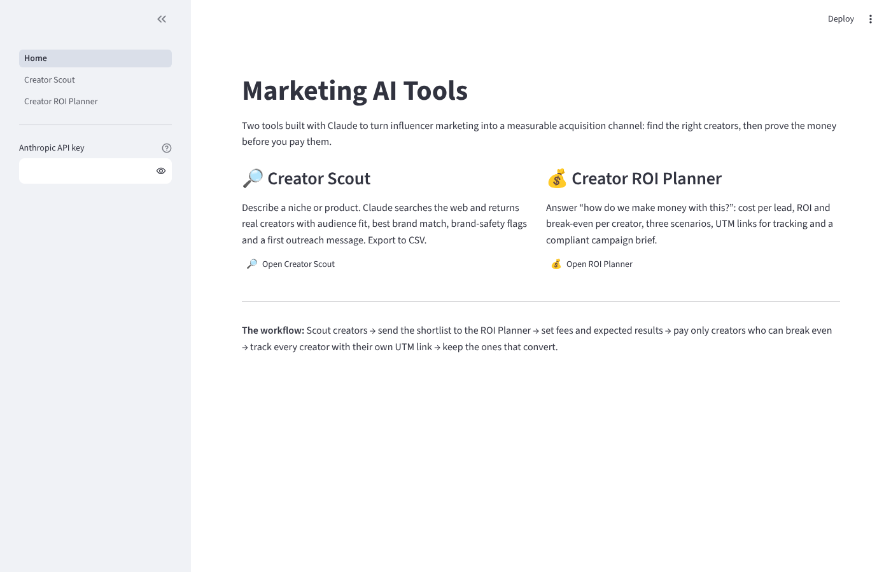
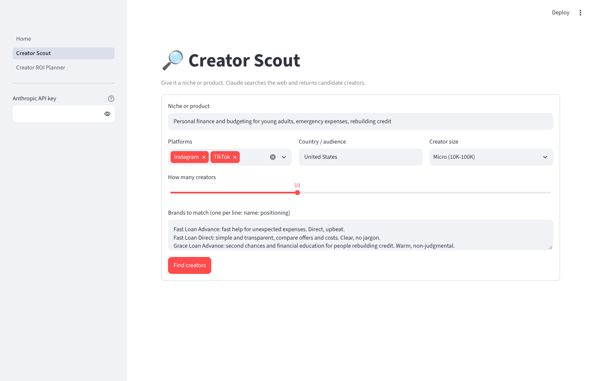
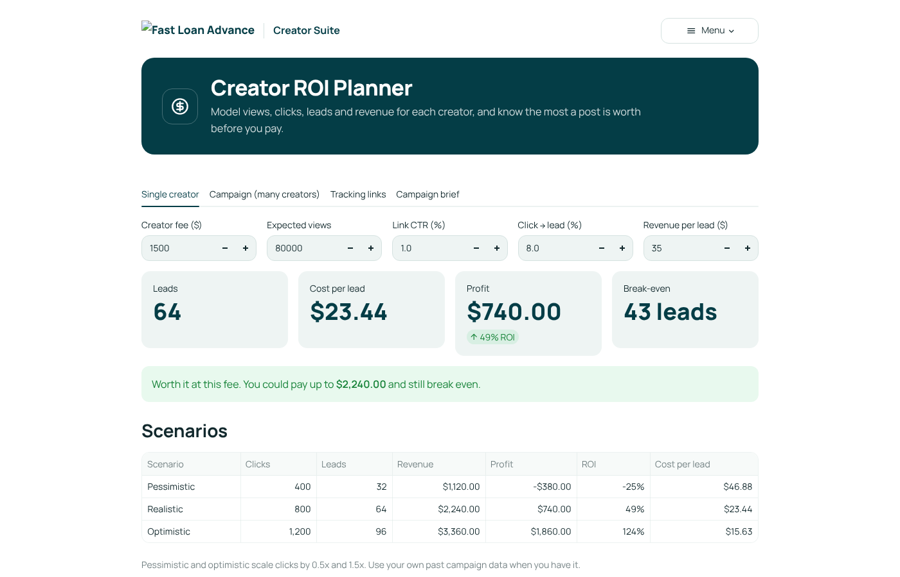
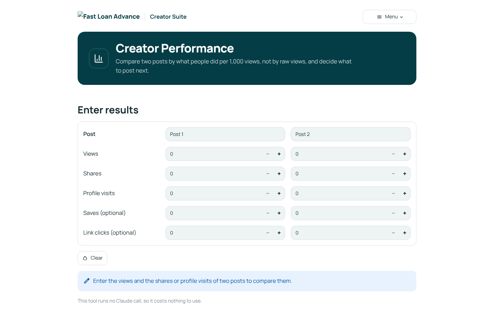

# Creator Suite: Marketing AI Tools

Influencer marketing tools for Fast Loan Advance, built with Claude: weekly trends, creator discovery and ROI planning.

Influencer marketing usually stalls on four questions: **what should we talk about?**, **who should we work with?**, **how does this make money?** and **what actually worked?** These four tools answer them, and they're built to work together.



## 📡 Creator Radar

What's getting attention in a segment this week on Instagram and TikTok: the top topics, why they're trending now, standout creators and posts (with sources and engagement when reported), the formats that are working, and a content idea for each one that fits a regulated financial brand.

- **On demand:** run a scan from the app for any segment.
- **Every Monday:** a GitHub Action (`.github/workflows/trend-radar.yml`) runs the radar, saves the report in `reports/`, and the app shows it under **This week's report**.

Instagram and TikTok can't be read directly, so Claude uses public pages that report on them (media coverage, trend roundups, platform trend pages, Google Trends). It only reports numbers it found.

To turn on the schedule, add the API key in the repo: **Settings → Secrets and variables → Actions → New repository secret**, name `ANTHROPIC_API_KEY`. You can also run it by hand from the **Actions** tab.

## 🔎 Creator Scout

Describe a niche or product, choose platforms, country and creator size. Claude searches the web and returns real creators it found, with:

- handle, platform, profile link and follower count (as published)
- what they post and why their audience fits
- a 1 to 10 fit score and the best brand match from your brand list
- brand-safety flags (get-rich-quick claims, controversies, competitor deals)
- a personal first outreach message

Export everything to CSV, or send the shortlist straight to the ROI Planner.



**How it works:** one Claude call with the web search tool does the research, and a second call turns the notes into a validated table (structured outputs). The prompt only allows creators found in search results, so it doesn't invent names or numbers.

## 💰 Creator ROI Planner

Treats every sponsored post as a small lead-gen campaign: **views → clicks → leads → revenue**.

- **Single creator:** cost per lead, profit, ROI, break-even leads and the maximum fee worth paying, with pessimistic, realistic and optimistic scenarios.
- **Campaign:** an editable table of creators that shows which ones to book and which to renegotiate (or move to a flat fee + bonus per lead).
- **Tracking links:** a UTM link per creator, so GA4 shows exactly who brings leads.
- **Campaign brief:** Claude writes a brief with FTC disclosure rules, finance-specific don'ts (no guaranteed approval claims) and a "needs legal review" list.



## 📊 Creator Performance

Compares two posts by what people did per 1,000 views, not by raw views. Enter views, shares and profile visits (saves and link clicks are optional); it highlights the higher rate, shows how many times better it is, recommends which post to build on and the follow-up post, and lists what the numbers can't tell you (watch time, traffic source, entries, sentiment, sample size). It never claims to predict virality, and it makes no Claude call, so it costs nothing to run.



## Run it locally

```bash
pip install -r requirements.txt
streamlit run Home.py
```

Paste your Anthropic API key in the menu (top right), or set it once in `.streamlit/secrets.toml`:

```toml
ANTHROPIC_API_KEY = "sk-ant-..."
```

Web search has to be enabled for your organization in the [Claude Console](https://console.anthropic.com) settings.

## Deploy (free)

1. Go to [share.streamlit.io](https://share.streamlit.io) and sign in with GitHub.
2. **Create app** → pick this repository, branch `main`, main file `Home.py`.
3. Under **Advanced settings → Secrets**, paste `ANTHROPIC_API_KEY = "sk-ant-..."`.
4. Deploy and share the link.

## Project layout

```
Home.py                         entry point: brand shell, menu, runs the chosen page
views/home.py                   overview and the money chain
views/radar.py                  weekly trends and content ideas
views/scout.py                  creator discovery
views/roi.py                    ROI, scenarios, UTM links, brief
core/ui.py                      Fast Loan Advance look: top bar, menu, page bands, icons
core/scout.py                   web research + structured extraction
core/roi.py                     ROI math and UTM builder (pure functions)
core/brief.py                   campaign brief prompt
core/radar.py                   trend research + report (also a CLI for the schedule)
core/llm.py                     Claude client, API key handling
reports/                        radar reports written by the GitHub Action
reports/briefs/                 one-page leadership briefs
.github/workflows/              Monday schedule
.claude/skills/                 Claude Code skills for this project
tests/                          unit tests and page smoke tests
```

## Claude skills

The repo ships two skills that Claude Code picks up automatically when it works in this folder:

- **`fla-brand-ui`**: the Fast Loan Advance design rules (colors, type, layout, menu, icons), written with Anthropic's [frontend-design](https://github.com/anthropics/skills/tree/main/skills/frontend-design) skill. Every UI change follows it.
- **`creator-weekly-brief`**: turns the latest radar report into a one-page leadership brief with three post ideas, the ROI of one sponsored post, next steps and a legal-review list. Example: [`reports/briefs/2026-10-24-weekly-brief.md`](reports/briefs/2026-10-24-weekly-brief.md).

Run the tests with `pytest`.

Built with [Claude](https://claude.ai) and [Streamlit](https://streamlit.io).
